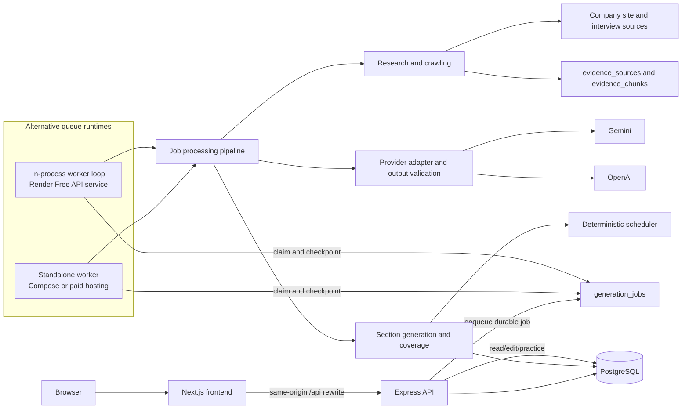

# PrepKit backend

The backend is a TypeScript service with an Express API and a durable job worker loop. Local Compose and production Compose run the API and worker as separate processes; the Render free-tier demo runs both in one API web process. PostgreSQL stores user accounts, sessions, versioned kit documents, normalized kit entities, research evidence, generation jobs/checkpoints, and practice history. Both runtime modes use the shared kit contract in `packages/kit-schema`.

## Local setup and commands

From the repository root, install dependencies with `npm ci`. Copy the environment templates as described in the [root quick start](../README.md#quick-start), configure `DATABASE_URL`, a random `SESSION_SECRET` of at least 32 characters, and at least one provider key. Start PostgreSQL using `docker compose up -d postgres`; then run the API and worker in separate root terminals:

```powershell
npm run dev:api --workspace backend
```

```powershell
npm run dev:worker --workspace backend
```

The API listens on port 8000 by default. It applies numbered schema migrations at startup and exposes `GET /api/health` for a readiness check. The worker claims queued work from the same database. For the full UI use `npm run dev --workspace frontend`; for the complete container stack use `docker compose up --build -d`.

Build and unit-test commands:

```powershell
npm run build --workspace backend
npm run test:unit --workspace backend
```

Integration tests use a separate PostgreSQL database configured with `TEST_DATABASE_URL`. Use a database name containing `test`; the suite skips when the variable is absent. Never set it to development or production data.

## Architecture



The API validates requests, authenticates and scopes operations to the current user, creates generation records, returns progress, persists edits, and manages practice/schedule state. It does not perform long model calls in the request path. The worker loop leases durable jobs, renews its heartbeat, resumes from completed checkpoints, and records stage outcomes. A process restart therefore does not discard already completed sections. `worker-runtime.ts` contains the reusable queue loop. Local Compose and paid production configurations run it as a separate worker process. The Render Free Blueprint starts that same loop alongside the API in one web process; both deployment modes use the same PostgreSQL-backed queue.

### Module map

| Concern | Main modules |
| --- | --- |
| HTTP routes, authentication, authorization, request validation | `src/app.ts`, `src/server.ts`, `src/auth.ts`, `src/config.ts` |
| PostgreSQL connection and migrations | `src/db.ts`, `src/migrations.ts` |
| Durable work, leases, retries, checkpoints | `src/job-runner.ts`, `src/worker.ts`, `src/retry.ts`, `src/pipeline.ts` |
| Safe retrieval, robots, link discovery/ranking, research sources | `src/research.ts` |
| Prompt construction, provider requests, output repair/cache | `src/llm-prompt.ts`, `src/llm.ts`, `src/llm-output.ts` |
| Requirements extraction and pipeline orchestration | `src/pipeline.ts` |
| Evidence storage/retrieval and deterministic coverage | `src/evidence.ts`, `src/evidence-retrieval.ts`, `src/coverage.ts` |
| Scheduling and schedule persistence | `src/scheduler.ts`, `src/schedule-persistence.ts` |
| Kit document and entity persistence | `src/kit-schema.ts`, `src/kit-data-schema.ts`, `src/kit-persistence.ts`, `packages/kit-schema/index.ts` |
| Regeneration and edit preservation | `src/regeneration.ts`, `src/pipeline.ts`, `src/app.ts` |
| Batch evaluation | `src/evaluate.ts`, `src/batch-runner.ts`, `src/evaluation-checks.ts` |

### Generation sequence

1. The API validates the job description, company details, and requested days, creates a kit with a pending snapshot, and enqueues a job.
2. The worker researches the official site and public interview reports. It fetches the official site's `robots.txt`, scores same-origin links for hiring/about relevance, and crawls a bounded number of pages. Unavailable or disallowed sources become warnings; they do not invalidate the job description.
3. It extracts requirements with evidence quotes and stable IDs, then generates the company brief, topics, interview-round research, categorized questions, and flashcards in separate stages. Evidence chunks are retrieved lexically for later prompts and persisted with their source IDs.
4. Deterministic coverage code compares question `requirement_ids` against must-have requirement IDs. If gaps exist, one targeted follow-up pass generates missing questions; coverage is checked again, with remaining gaps retained explicitly.
5. Deterministic scheduling distributes questions and flashcards across exactly the requested 1 to 60 days. It uses integer minutes and prioritizes must-have requirements, difficulty, and duration.
6. The kit is validated against the shared schema and persisted. Generation warnings and uncovered requirements affect readiness; the UI can identify a kit needing review without hiding partial output.

The schema in `packages/kit-schema` retains the assignment's required names and types: `source`, `company_brief`, `role`, `questions`, `flashcards`, `schedule`, and `coverage`. The app extends the kit with topics, interview research, progress, origin, evidence, and archive metadata. Schedule IDs must resolve to active kit items.

## Data model and edit safety

`kits.data` stores the complete JSONB document used to reopen the builder. Related tables index requirements, topics, questions, cards, schedule days, source evidence, sessions, and job state. This keeps the user-facing document easy to load while allowing ownership checks, progress queries, retries, and transactional updates. Foreign keys cascade user deletion into owned data; API queries additionally scope kits and nested resources by user ID.

Each kit has an integer version. The client submits the version it edited, and a compare-and-update transaction rejects stale writes with HTTP 409. A regeneration job has durable section status and JSON checkpoints. Generated, edited, pinned, and user-authored items retain origin metadata. Regeneration archives superseded generated content and keeps manual items and unrelated sections intact. A category regeneration only replaces generated items in that question category; schedule regeneration uses the current kit and does not rerun research or model generation.

Practice sessions and response items are stored separately from the generated kit. Ratings are associated with the user and card, and calculate a simple due time: 15 minutes, 1, 2, 4, or 7 days for confidence ratings 1 through 5. Schedule completion is stored separately from card state.

## Research sources and security

Research starts at the company URL supplied by the user (or an official homepage found for a company name). Link discovery is content-driven, ranks links using hiring/about terminology and page context, and follows relative links within the site's origin; it does not rely on a fixed careers path list. Crawling checks the site's `robots.txt`, waits between requests, and limits pages, response bytes, timeout, and redirects.

Public interview research uses Gemini Google Search grounding when a Gemini key is configured, the Hacker News Algolia search API, and DuckDuckGo HTML search as a fallback. Search candidates are filtered for relevance and company/role matches. If no company-specific reports are found, role-level results may be included with that scope labeled. Candidate accounts are anecdotal. Search result pages are references; only verified grounding URLs are accepted from Gemini results. When a source cannot be reached, the source is skipped and its warning is saved. The crawler honors `robots.txt` and is deliberately bounded; users should also follow the target site's terms and access policies.

The fetcher accepts HTTP(S) only, rejects embedded credentials, nonstandard public ports, private/internal DNS results, loopback, and redirect destinations that fail the same checks. Requests are pinned to a resolved address to mitigate DNS rebinding. Local loopback fixture URLs with custom ports are allowed only in the batch runner for evaluation. HTML is reduced to readable text; scripts, navigation, forms, and hidden content are removed. Retrieved content and job descriptions are treated as untrusted data in prompts, never as instructions. Request schemas and generated kit schemas are validated before persistence.

## Reliability and model behavior

Gemini and OpenAI are supported. Provider calls are serialized with PostgreSQL advisory locks and spaced by `LLM_MIN_REQUEST_INTERVAL_MS`. Successful outputs are cached for 30 days by task, input, provider/model, and prompt version. JSON or schema failures get one repair attempt. Transient provider errors are retried; quota responses defer work until their cooldown so a rate-limited job remains resumable. Non-transient unusable section output is handled with clearly marked fallback content and review warnings. The pipeline never claims that fallback research is verified evidence.

## Batch entry point

From the repository root, run the mandatory command:

```powershell
npm run evaluate -- --input cases.json --output kits.json
```

Input is an array with `{ "id": string, "jd": string, "company_url": string, "days": integer }`. Output has `{ "version": "1.0", "generated_at": ISO-8601, "kits": [...] }`, with one case entry per input. A produced kit has `status: "ok"` even when research is partial; gaps and warnings remain in its kit. `failed` is reserved for cases where no kit could be produced, and the runner continues after a failed case. It uses each case's `days` value and the same `runPipeline` as the interactive worker.

The batch command requires PostgreSQL and an available configured provider. It allows localhost fixture hosts only in this evaluation path, to support test websites. The checked-in 15-case job set is `evals/jobs.json`; deterministic acceptance checks and invocation details are in [`evals/README.md`](evals/README.md). Results can contain generated content and should remain private.

## Deployment

The Compose definitions are in the repository root. `docker-compose.backend.yml` runs PostgreSQL, API, and worker; `docker-compose.frontend.yml` runs the frontend against the host API; the default `docker-compose.yml` runs the complete local stack. `docker-compose.production.yml` keeps PostgreSQL and API private and places Caddy in front of the frontend for HTTPS. Configure `.env.production` with the domain, database credentials, session secret, and model credentials, then use the production Compose file with `--env-file .env.production`. Back up PostgreSQL outside its Docker volume.

The Render Blueprint in `render.yaml` uses free web services for the frontend and API plus a free PostgreSQL database. The API web service also runs the queue loop because Render Free does not include private services or background workers. The frontend rewrites `/api` requests to the API's public HTTPS URL; this is a server-side proxy, so the browser continues to use same-origin paths. Free web services can spin down and share monthly instance-hour limits; free PostgreSQL is limited to 1 GB and expires after 30 days. Treat this as a temporary demo, not durable production hosting. See [Render's current free-tier limits](https://render.com/docs/free). To launch, push this repository to GitHub, connect it in Render using **New > Blueprint**, enter a provider key when prompted, and deploy. The frontend address follows the service name in `render.yaml`; if either service name changes, update `FRONTEND_ORIGIN` or `BACKEND_INTERNAL_URL` to match.

See the [root README](../README.md) for environment setup, service commands, and test commands.
